<!-- HERO ANIMATED BANNER -->

  

<!-- ANIMATED MULTI-LINE TYPING TERMINAL -->

  

  
  
  

  

<!-- CUSTOM ANIMATED RADAR + EQUALIZER + LIVE LOG HUD -->

  

<!-- CUSTOM ANIMATED CYBER-MAFIA SMOKING SYNDICATE CARD -->

  

<!-- KALI LINUX ZSH NEOFETCH TERMINAL -->

  

  

### `// ARSENAL & WEAPONRY`

<!-- HUMAN NEURAL CORTEX SYNAPSE TOPOLOGY OF SKILLS & TOOLS -->

  

  

  
  
  

  

### `// SYSTEM TELEMETRY & ACTIVITY`

  
  

  

<!-- ANIMATED CONTRIBUTION SNAKE (Membutuhkan workflow .github/workflows/snake.yml) -->
### `// CONTRIBUTION PAYLOAD INGESTION`

> *"Every commit is a pulse in a lifelong archive of creation, spanning personal R&D, resilient architectures, and borderless engineering. Driven by an unyielding pursuit of mastery, each line of code is forged to nurture continuous growth and contribute meaningfully to the advancement of technology on the global stage."*

  

  

### `// CONNECT & COLLABORATE`

  <i>"Every groundbreaking system begins with a single connection. Reach out through any of the channels below, let’s connect, collaborate, and engineer the future together."</i>

  
  
  
  
  

  

