<h2 align="center">Hi there 👋 — <code>welcome to my code lab</code></h2>

<!-- HERO ANIMATED BANNER -->

  

<!-- ANIMATED MULTI-LINE TYPING TERMINAL -->

  

  
  
  

  

<!-- CUSTOM ANIMATED RADAR + EQUALIZER + LIVE LOG HUD -->

  

<!-- CUSTOM ANIMATED CYBER-MAFIA SMOKING SYNDICATE CARD -->

  

<!-- KALI LINUX ZSH NEOFETCH TERMINAL -->

  

  

### `// ARSENAL & WEAPONRY`

> *"Where scattered instruments collide in the dark, a living mind takes shape, wiring raw code, silent forensics, and decentralized trust into one pulse, turning every scar of collision into quiet mastery, leaving only clean logic behind, long after the lights gently dissolve back into the void, endlessly evolving in the quiet until silence itself becomes the blueprint for whatever stands in tomorrow."*

<!-- 4D NEURAL PLEXUS HYPER-SYNAPTIC TOPOLOGY OF SKILLS & TOOLS -->

  

  

  
  
  

  

### `// SYSTEM TELEMETRY & ACTIVITY`

  
  

  

<!-- ANIMATED CONTRIBUTION SNAKE (Membutuhkan workflow .github/workflows/snake.yml) -->
### `// CONTRIBUTION PAYLOAD INGESTION`

> *"Every commit is a long breath in a builder's lifelong chronicle, uniting personal R&D, resilient systems, and borderless engineering. Driven by a love for a craft one never finishes learning, each line of code is forged to keep growing, and to carry a small light for the world's technological civilization, across all time."*

  

  

### `// CONNECT & COLLABORATE`

  <i>"Every groundbreaking system begins with a single connection. I dream of a future we write together, where code is so remarkably alive that it bridges minds across borders and turns bold visions into reality. Reach out through any of the channels below, let’s connect, collaborate, and engineer the future together."</i>

<!-- CUSTOM CYBER-OPS CHANNEL ICONS -->

  &nbsp;&nbsp;&nbsp;&nbsp;&nbsp;&nbsp;&nbsp;&nbsp;

